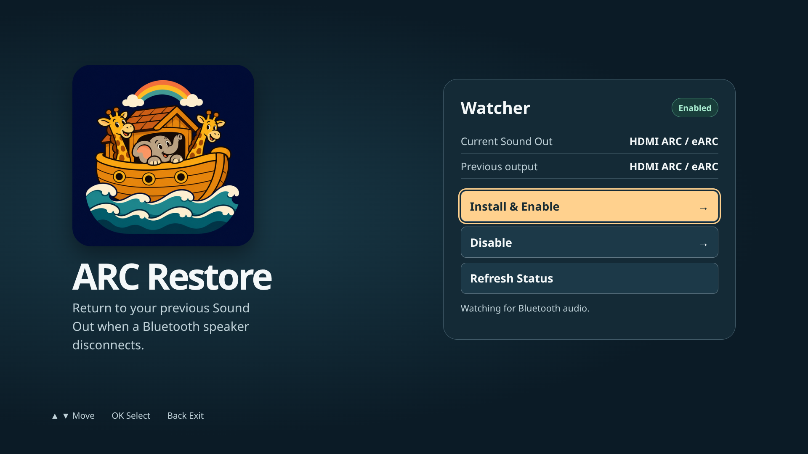

# ARC Restore

ARC Restore returns a rooted LG webOS TV to its previous **Sound Out** when disconnecting a Bluetooth speaker sends audio back to the built-in TV speakers. Tested on an LG C3 running webOS 24 with an HDMI ARC/eARC soundbar.

[Download the v1.0.0 IPK](https://github.com/braunglasrakete/lg-webos-arcrestore/releases/download/v1.0.0/org.arc-restore.app_1.0.0_all.ipk)

## Install and enable

Requires a rooted LG webOS TV with [Homebrew Channel](https://github.com/webosbrew/webos-homebrew-channel) and its root service working.

1. Sideload the IPK. If you use the webOS CLI, replace `webos` with your device name.

   ```sh
   ares-install -d webos org.arc-restore.app_1.0.0_all.ipk
   ```

2. Select your usual **Sound Out**, such as HDMI ARC/eARC.
3. Open **ARC Restore** and select **Install & Enable**. Use the remote's up/down arrows and OK button, or the Magic Remote pointer.
4. Connect a Bluetooth speaker, then turn it off. Confirm audio returns to the previous output.

The watcher starts through Homebrew Channel's boot hook. It can take a few seconds to become active after reboot. **Refresh Status** shows the watcher state and the outputs it sees. Select **Disable** to stop the watcher and remove its boot hook before uninstalling the app.

The watcher detects the transition from Bluetooth audio to TV Speaker. Selecting TV Speaker manually while Bluetooth audio is active can trigger the same restore.

## Build from source

Use the LG [webOS TV CLI](https://webostv.developer.lge.com/develop/tools/cli-dev-guide), or run the pinned CLI through npm from the repository root:

```sh
npx --yes --package @webos-tools/cli@3.2.6 ares-package --no-minify -o . app
```
